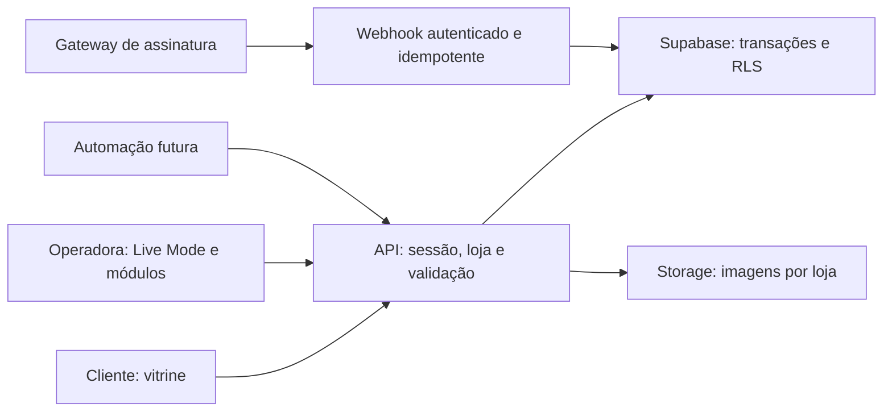

# Arquitetura — Micro-SaaS híbrido de confeitaria

**20/11/2026 · Proposta de implementação vinculada ao PRD 1.0**  
Este guia descreve o destino e a sequência técnica. Não é uma migração aplicada. [PRD](PRD.md) · [Backlog](ROADMAP.md).

## 1. Decisões e fronteiras

| Assunto | Decisão proposta | Situação atual |
| --- | --- | --- |
| Web | Opção Next.js App Router com React reaproveitado e BFF na Vercel; confirmar ADR | React/Vite; Next ainda não instalado |
| Dados | Postgres/Supabase com regras transacionais e RLS por loja | RLS de administradora de loja única |
| Identidade | Supabase Auth, sessão verificada no servidor e associação ativa à loja | Login web com renovação; validação operacional pendente |
| Native | Consumir API versionada; manter interface reaproveitável | Capacitor com arquivos web compilados em dist |
| Cobrança SaaS | Adaptador de gateway, eventos idempotentes e direitos no servidor | Não implementada |
| Operação | Pedido é fonte comum para capacidade, produção, CRM e recebimentos | Checkout apenas compõe WhatsApp |

**ADR-01 pendente.** Conferir Vite + API na Vercel versus migração para Next.js com BFF. Next é a stack sugerida no briefing, mas a intenção de manter a base existente precisa considerar que ela é Vite. Recomendação do executor: preservar a operação urgente e decidir a migração após um ensaio pequeno de sessão, rotas e Capacitor; não tratar a reescrita como requisito do SaaS.

O MVP comercial não exige microserviços. Usar módulos claros no mesmo código e funções HTTP para pedidos, edição, webhooks e integrações. Agendamentos e tarefas duráveis entram quando houver necessidade demonstrada, sem contratar ferramentas nesta definição.

## 2. Identidade e autorização

Resolver o slug para uma loja pública não concede gestão. Para cada ação administrativa: verificar identidade com o provedor; obter membership ativo; conferir ação/função e direito do plano; validar payload; executar a operação no contexto correto. Repetir o controle junto do acesso ao dado e na política do banco.

Proxy/redirecionamento pode melhorar a navegação, mas não constitui autorização completa. Na documentação atual, Next.js usa Proxy para o mecanismo antes conhecido como Middleware; definir versão suportada durante a migração. A proteção pertence também à DAL, aos Route Handlers e às Server Actions. [Next.js: Proxy](https://nextjs.org/docs/app/api-reference/file-conventions/proxy) · [Segurança dos dados](https://nextjs.org/docs/app/guides/data-security).

Operações normais de membros usam o JWT da pessoa e RLS. Não trocar por service_role para contornar uma política. Um cliente privilegiado de servidor, isolado do cliente comum, é reservado a trabalhos administrativos necessários, como processar evento do gateway. Nesse caminho, validar origem, vínculo do objeto externo com a loja e escopo explicitamente, pois a chave privilegiada ignora RLS.

No navegador usar URL e chave publicável. No Next, preferir NEXT_PUBLIC_SUPABASE_URL e NEXT_PUBLIC_SUPABASE_PUBLISHABLE_KEY. A chave anon é compatibilidade legada. No Vite atual, manter as variáveis VITE já configuradas até a migração. Chaves secret/service_role e segredos Stripe/IA/WhatsApp não podem ter prefixo público nem entrar em Git, bundle, logs ou respostas. [Chaves do Supabase](https://supabase.com/docs/guides/getting-started/api-keys).

## 3. Modelo de dados proposto

Nomes são destino conceitual. Preservar identificadores e contrato legado até passar a migração. Não renomear todas as tabelas de uma vez.

| Entidade | Campos/relações essenciais |
| --- | --- |
| stores | id, slug único, nome, marca, moeda, timezone, visibilidade; apenas metadados públicos necessários |
| store_members | store_id, user_id, papel, estado; unicidade loja/usuário e atribuição protegida |
| store_settings | store_id, regras de entrega, antecedência, sinal e demais configurações privadas/públicas explicitamente separadas |
| categories / topics | store_id, id, ordem, nome; tópicos embutidos herdam o escopo da categoria até normalização |
| products / variants | store_id, id, categoria, publicação e modalidades; preço de venda e moeda; sem custos privados no JSON público |
| ingredients / recipes / recipe_items | store_id, unidade, compra, revisão, rendimento e referência a ingrediente/sub-receita |
| customers / customer_addresses | store_id, contato, preferências e moradas necessárias |
| orders / order_items | store_id, cliente, estado, versão, datas e snapshot de item/opção/preço |
| inventory_movements / stock_reservations | store_id, produto/opção, quantidade, motivo, pedido, validade e chave idempotente |
| capacity_rules / calendar_blocks / capacity_reservations | store_id, grupo, data local, limite e reserva por pedido |
| order_payments / expenses | store_id, pedido quando aplicável, montante, moeda, método, estado, estorno e responsável |
| store_subscriptions / entitlements | store_id, IDs de gateway, plano, estado, períodos e direitos; não públicos |
| webhook_events / audit_events / outbox | store_id quando do negócio, provedor/evento único, ação, responsável, estado e metadados mínimos |

store_id é obrigatório nas entidades operacionais. stores é a raiz, e tabelas globais de identidade, migrações e catálogo de planos não recebem uma autorreferência artificial.

Usar relações compostas com (store_id, id), por exemplo pedido/cliente e item/produto, para impedir ligações entre lojas. Índices nas colunas de escopo e consulta; unicidades e idempotência também incluem loja quando apropriado. Impedir transferência de store_id depois de criar o registro, salvo migração administrativa específica. Alterar role ou membership exige autorização própria.

Dinheiro em cêntimos inteiros e moeda explícita nos novos contratos; não usar float para total, sinal ou saldo. Fazer conversões de escala na fronteira com o legado e testar arredondamento. Guardar timestamps em UTC; horários de funcionamento, corte diário e capacidade usam timezone da loja. Estoque por unidade de venda e quantidades de ingredientes têm unidades e precisões distintas.

## 4. RLS e exposição pública

Ativar RLS em cada tabela de dados exposta e definir grants mínimos. Catálogo publicado e metadados públicos da loja podem ter leitura anônima restrita. Pedidos, receitas, ingredientes, clientes, pagamentos, despesas, logs e assinatura não são públicos. Não colocar preço de custo ou notas internas no objeto de produto que o visitante recebe.

Para membros, SELECT/DELETE conferem associação ativa e função. INSERT confere a loja de destino; UPDATE confere origem e destino com USING e WITH CHECK. Verificar o direito de escrita quando o plano estiver suspenso. Nunca usar user_metadata editável como prova de papel.

Store_id no filtro da UI não é proteção. RPCs, funções privilegiadas, exports, Storage e cache precisam do mesmo escopo. Views públicas devem projetar campos mínimos e conservar a proteção de acesso, em vez de introduzir um caminho que ignora RLS. [RLS do Supabase](https://supabase.com/docs/guides/database/postgres/row-level-security).

Matriz mínima de testes: visitante, membro A, membro B, pessoa autenticada sem membership, membro removido e papel insuficiente. Testar IDs conhecidos e referências cruzadas, não só filtros de listagem. Um membro legítimo de A e B ainda não pode ligar cliente de A a pedido de B.

## 5. Storage e arquivos

Novo caminho: bucket/store_id/uuid.ext. A política confere o primeiro segmento contra memberships e a função exigida; não confiar no nome informado pelo navegador. Nome aleatório, extensão/MIME e tamanho validados; aceitar apenas imagens efetivamente decodificáveis para catálogo.

O briefing propõe 2 MB; adotar esse teto para a imagem final otimizada na futura fase multi-loja, após testar qualidade. Hoje o limite é 20 MB de entrada e 5 MB otimizado: não declarar o novo teto ativo nem bloquear retroativamente arquivos existentes. A mesma fotografia aceita gera prévia e envio.

Separar imagens públicas de catálogo de documentos privados, como comprovantes. Caminho por loja protege escrita, mas bucket público não torna o conteúdo confidencial. Documento privado exige autorização e URL temporária adequada. [Controle de acesso do Storage](https://supabase.com/docs/guides/storage/security/access-control).

## 6. Contratos e transações

Rotas propostas /api/v1/stores/[storeId]/... com contexto verificado; slug é para descoberta pública. Schemas Zod no servidor para entrada, saída pública e mensagens de erro. DTOs distintos para visitante e operação.

| Operação | Comportamento obrigatório |
| --- | --- |
| PATCH products/:id | Permissão, versão esperada, modalidade válida e auditoria; preservar opções/ficha |
| POST inventory-adjustments | Movimento com motivo e idempotência; nenhuma quantidade negativa |
| POST orders | Recalcular preço/opções/entrega, conferir regras, reservar estoque/capacidade e criar snapshot atomicamente |
| POST orders/:id/confirm | Transição permitida, validade de orçamento/sinal e reserva ainda válida |
| POST orders/:id/cancel | Liberar reservas uma vez; pagamento/estorno é operação separada |
| POST orders/:id/payments | Recebimento ou estorno autorizado, moeda/montante e idempotência |
| GET production-summary | Somar apenas estados elegíveis, opções e janela local; sem mutações |
| POST billing/webhook | Assinatura do provedor, deduplicação, vínculo da loja e transição de direitos |

Preço, estoque e capacidade são calculados/verificados em transação no Postgres, com bloqueio/atualização condicional apropriados. Checar disponibilidade no React e gravar depois permite corrida e não atende ao requisito.

Chave idempotente com loja/usuário ou sessão de checkout e hash do payload: repetição devolve o mesmo resultado; chave reaproveitada com conteúdo diferente é conflito. Não manter transação de banco aberta enquanto chama WhatsApp, gateway ou IA. Publicar tarefas pela outbox após o commit.

Rate limiting distribuído no endpoint público de pedidos e nas ações sensíveis; combinar IP e loja/sessão, tamanho de payload, timeout e resposta 429. Bloquear INSERT anônimo direto em orders e RPC equivalente que contorne o endpoint protegido. A mitigação do domínio Vercel não protege automaticamente uma rota pública direta do Supabase.

## 7. Assinatura e eventos

Manter cobrança SaaS em namespace separado de pagamentos de encomenda. Não ativar plano por redirect de sucesso ou campo enviado pelo browser.

Validar assinatura do webhook usando o corpo exigido pelo provedor; registrar ID externo único; tratar entrega duplicada e fora de ordem, reconciliar estado quando necessário e permitir retry seguro. O gateway identifica a assinatura; a loja é resolvida pelo vínculo já registrado. [Webhooks Stripe](https://docs.stripe.com/webhooks) · [Eventos de assinatura](https://docs.stripe.com/billing/subscriptions/webhooks).

Restringir acesso por entitlements confiáveis. Falha ou cancelamento da assinatura não apaga dados. Definir carência e leitura/exportação antes de lançar. Não anunciar integração com vários gateways na primeira entrega: implementar um adaptador testado no mercado escolhido.

## 8. Migração e compatibilidade

1. Preservar base funcional, backup recuperável e evidências; usar ambiente de teste com duas lojas fictícias.
2. Extrair/reusar componentes de domínio, tokens e cálculos. Se Next for escolhido, migrar preservando as rotas legadas /, /admin e /precificacao, SEO, links de recuperação e prévias de partilha preservados.
3. Criar stores e store_members; registrar a Presente Doce como loja piloto e migrar sua associação administrativa. Não alterar senha nem recriar a conta de operação.
4. Adicionar store_id inicialmente compatível, preencher com o piloto e conferir contagens, IDs, rascunhos, tópicos e fichas. Criar índices e relações compostas; exigir NOT NULL quando todos os registros estiverem conferidos.
5. Preparar políticas por loja e adaptar RPCs/storage antes de abrir nova loja. Ensaiar a aplicação coordenada de grants, políticas e frontend. Não deixar a política global antiga permitindo acesso à segunda loja.
6. Preservar caminhos de imagens antigos com mapeamento de compatibilidade; copiar/validar quando necessário, sem apagar originais na primeira etapa.
7. Testar o cliente antigo, os novos contratos e reversão do frontend. Migração de dados não é desfeita automaticamente pelo rollback de deploy.
8. Liberar módulos por capacidade funcional real; executar piloto da segunda loja antes de onboarding público.

Next com SSR/Server Actions não pode ser simplesmente copiado para o dist do Capacitor. O cliente nativo deve consumir a API hospedada ou um frontend compatível; revisar CORS, retornos de auth, armazenamento seguro e versões de contrato. Não publicar uma URL remota como substituição silenciosa do pacote atual.

## 9. Segurança operacional e observabilidade

Separar dev/teste/produção e bancos de teste; previews não devem fazer mutações em dados de operação por padrão. Não registrar senhas, tokens, áudios completos ou moradas em logs de erro. Eventos de auditoria incluem loja, ator, ação, entidade, resultado e horário, com acesso e retenção definidos.

Configurar CSP/headers, validação de sessão e origem nas ações, limites de login, backup/restauração, alertas e correlação de falhas sem dados pessoais desnecessários. Verificar segredos no Git/bundle e considerar revogação se algum tiver sido exposto; apenas apagar do último commit não resolve exposição histórica.

Gate de lançamento comercial: testes de isolamento em tabelas/RPC/Storage/cache, concorrência, eventos de cobrança, funções sem permissão e matriz mobile/desktop. O cenário físico e a validação da operadora continuam distintos dos mocks de interface. Integrações novas exigem conta/ferramenta e escopo antes de ativação.
