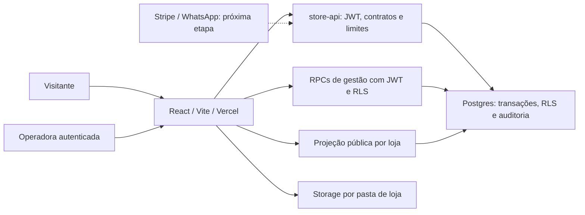

# Arquitetura — Plataforma híbrida de confeitaria

**20/11/2026 · Implementação do PRD 1.1.** [Estado e limites](IMPLEMENTACAO.md) · [Roadmap](ROADMAP.md) · [Integrações futuras](INTEGRACOES.md).

## Decisão de stack

ADR-01 encerrada por Erick: manter React 19, TypeScript, Vite 6 e Tailwind. Vercel publica o frontend estático. Supabase fornece Auth, Postgres, Storage e Edge Functions. Não há migração para Next.js ou obrigação de usar Server Actions. O mesmo frontend compilado continua compatível com as bases Capacitor.

O repositório é único. A cópia local serve para editar e testar; o commit revisado segue ao GitHub e gera preview/produção na Vercel. A loja e a gestão consultam a mesma base, sem catálogo duplicado.

## Contexto da loja e identidade

/ abre o piloto; /lojas/slug resolve a loja pública antes de montar a aplicação. Slug inexistente mostra erro e não cai no catálogo do piloto. x-store-id seleciona o contexto dos pedidos ao Supabase; esse cabeçalho não autoriza gestão. Membership, papel e entitlement são conferidos no servidor e no banco.

Sessões são verificadas pelo Supabase e renovadas com refresh token. Armazenamento é separado por loja; a chave legada do piloto foi preservada. A opção de lembrar sessão usa localStorage; acesso temporário usa sessionStorage. A senha não é guardada pelo formulário. A prévia oculta controles sem trocar credenciais.

Owner/manager ativos consultam a gestão. Staff não recebe acesso aos módulos privados nesta entrega. Escrita exige plano internal ou active/trial dentro da validade. Expiração/inadimplência/cancelamento preservam consulta e exportação e recusam mutações. O dono do piloto não é administrador global.

A API verifica Bearer junto a /auth/v1/user e a associação à loja. Nas mutações administrativas, encaminha o JWT da pessoa ao Postgres. Não usa service_role para contornar a RLS dessas operações. A chave privilegiada do runtime é usada no pedido público transacional, após validação e limite, e na montagem da resposta canônica.

## Dados implementados

| Área | Tabelas |
| --- | --- |
| Plataforma | stores, store_members, store_entitlements |
| Vitrine e fichas | catalog_products, catalog_categories, store_presentation, pricing_recipes |
| Configuração | store_settings |
| Operação | orders, order_items, customers, calendar_blocks |
| Estoque | product_stock, stock_movements, ingredients |
| Financeiro | finance_entries |
| Auditoria | audit_events |

As 17 tabelas públicas têm RLS. Dados operacionais contêm store_id NOT NULL, índices e relações compostas nos vínculos entre entidades. Troca de store_id é recusada por trigger. Categorias mantêm unicidade por loja/nome e IDs estáveis para tópicos. A conta antiga foi associada ao piloto sem recriar usuário ou senha.

Projeções storefront_config e storefront_availability mostram apenas dados necessários à vitrine. Pedidos, receitas, clientes e finanças não têm SELECT anônimo. orders não concede INSERT direto ao visitante, e checkout_order só concede execução ao runtime privilegiado.

Funções transacionais SECURITY DEFINER têm search_path vazio, grants fechados e checagem interna de gestão/plano ou escopo público validado. Os avisos do linter sobre essas funções são documentados em [IMPLEMENTACAO](IMPLEMENTACAO.md); mantê-las públicas não é concessão de escrita anônima.

## Pedido, reserva e financeiro

A API recebe IDs, opções, quantidade, modalidade, data e contacto. Zod recusa valores extras como preço enviado pelo navegador. O banco lê preços, massas/recheios/acréscimos atuais, consulta a ficha para custo unitário e grava snapshots.

Idempotency_key e hash do conteúdo evitam repetir pedido/reserva; reutilizar uma chave com outro conteúdo é erro. Estoque usa decremento condicional e locks. Capacidade usa trava por loja/data e soma de unidades de produção, incluindo concluídas. A reserva não pode deixar saldo negativo nem exceder o dia.

Solicitações públicas ficam pendentes por 30 minutos. Expiração/cancelamento libera a reserva uma vez. Orçamento fica sem reserva até confirmar. Confirmação exige disponibilidade atual. A taxa de entrega desconhecida fica explícita e precisa ser definida antes da confirmação.

Financeiro é ledger: recibo, estorno ou despesa. Locks e idempotência evitam duplicação e recebimento/estorno acima do saldo. Cancelar não devolve dinheiro automaticamente. O custo histórico da encomenda não muda ao editar ingrediente, receita ou preço. Resultado incompleto por falta de fichas é identificado na UI.

## Ingredientes, sub-receitas e produção

A ficha aceita custo manual, ingredientId ou recipeId da mesma loja. O banco resolve nome, unidade, embalagem e custo. Alterar um ingrediente atualiza fichas dependentes; ciclos e exclusão de sub-receita usada são recusados. Não converter g em ml sem fator específico.

A Agenda soma itens por período e calcula demanda de insumos das encomendas confirmadas, respeitando rendimento e sub-receitas. Desconta o saldo informado e calcula embalagens. Itens de pronta entrega não geram produção nova. Fichas ausentes deixam aviso e lista incompleta. Não há baixa automática de insumos nesta etapa.

## Imagens, marca e dados públicos

Uploads usam catalog-images/store_id/UUID.webp ou .jpg. A política exige membro e plano da loja. O arquivo otimizado tem limite de 2 MiB e MIME WebP/JPEG; a entrada pode ter até 20 MiB para compressão. Pastas legadas catalog/ ficam restritas ao piloto. Não apagar imagens antigas durante a migração.

Configuração de marca valida nome, cor hexadecimal, contraste para branco, moeda, fuso e caminhos permitidos de logótipo. Galeria aceita imagens/categorias da própria loja. Novo lojista recebe marca genérica, não a identidade do piloto. CSS arbitrário não é aceito.

## Limites e integrações

Checkout tem corpo máximo de 64 KiB, timeout, origem permitida e contador distribuído no banco: 20 tentativas por IP/loja e 300 por loja em 10 minutos. A rota direta do Supabase também está protegida; firewall Vercel não a protege por si só. Login segue limites do Auth; Turnstile e proteção de senhas vazadas dependem da configuração do provedor.

Não publicar segredos em VITE_*, Git, bundle ou logs. O cliente usa apenas URL/chave publicável. SUPABASE_SERVICE_ROLE_KEY é injetada no runtime gerenciado. Integrações externas futuras exigem identidade verificável, escopo mínimo, deduplicação e auditoria.

Stripe foi escolhida, mas conta/preços/webhook/cobrança estão na próxima etapa por decisão de Erick. Onboarding está implementado e desativado por padrão. Não ativar plano por redirect ou campo do cliente. WhatsApp continua por wa.me; não existe provedor Business API/n8n conectado.

## Publicação, recuperação e escala

Todas as migrações são versionadas. Backup privado anterior à fundação fica ignorado pelo Git. Aplicação das migrações do zero é ensaiada em Postgres local, e operações concorrentes foram conferidas na API real com duas lojas descartáveis. O frontend anterior continua lendo o piloto sem cabeçalho de loja.

Preview/testes não devem mutar dados reais de operação. Ensaios de UI usam API isolada; fixtures remotas são identificadas e removidas. Rollback de frontend não reverte dados novos. Não executar restore antigo sobre encomendas posteriores.

Antes da venda em volume: conta/gateway, privacidade/retenção, recuperação integral ensaiada, paginação de grandes históricos, observabilidade e dimensionamento do snapshot de gestão. Antes das lojas nativas: SDKs, armazenamento adequado de sessão, retornos de autenticação, assinatura e teste físico. Sincronizar Capacitor não produz APK/IPA assinado.
